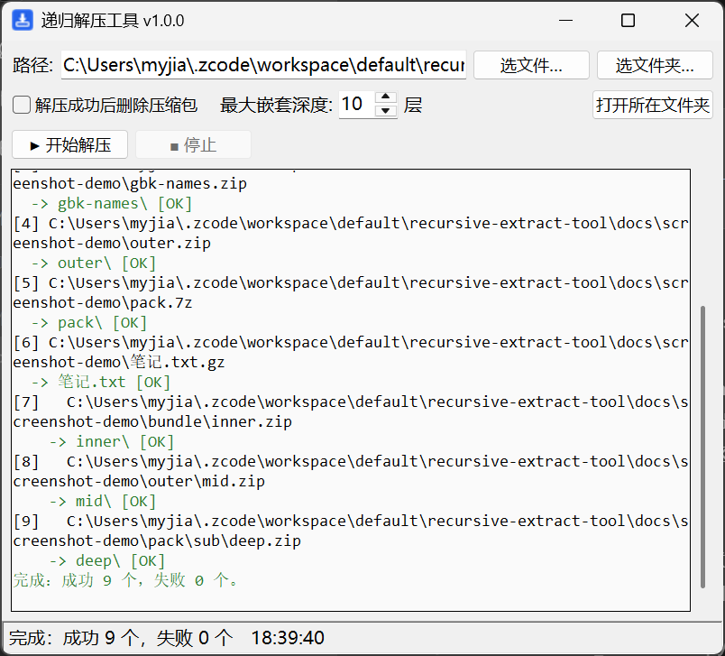

# 递归解压工具 RecursiveExtract

[](../../actions/workflows/ci.yml)
[](https://www.python.org)
[](https://github.com)
[](./LICENSE)

Windows 下的递归解压小工具：给定一个压缩包或一个目录，把里面所有压缩包解压出来；
解压产物里如果还有嵌套的压缩包（zip 里套 zip），会继续解压，直到没有新的压缩包为止。

A recursive archive extractor for Windows with a tiny GUI — point it at a
folder or an archive, and it keeps extracting nested archives until nothing
left to extract.



## ✨ 特性

- **递归解压**：自动处理任意嵌套的压缩包（默认最深 10 层，可调）
- **格式全**：zip / tar / tar.gz / tgz / tar.bz2 / tar.xz / gz / bz2 / xz 开箱即用；
  7z / rar 自动调用本机 7-Zip / WinRAR / tar
- **图形界面 + 命令行**双模式，exe 单文件免安装
- **中文友好**：自动修复 zip 内 GBK / Big5 / Shift-JIS 编码的乱码文件名
- **安全**：拦截压缩包内的路径穿越条目（Zip Slip）；深度上限防止"压缩包炸弹"撑爆磁盘
- **稳**：超长路径自动加 `\\?\` 前缀；单个压缩包损坏或加密只记失败，不中断整体
- 零第三方运行时依赖（Python 标准库实现）

## 📥 下载使用

从 [Releases](../../releases/latest) 下载 **`递归解压工具.exe`**，双击即用（无需安装 Python）：

1. 点「选文件…」或「选文件夹…」选择目标，或直接把压缩包/文件夹拖到 exe 图标上
2. 按需勾选「解压成功后删除压缩包」、调整嵌套深度
3. 点「▶ 开始解压」，日志实时显示进度，可随时停止

exe 也支持自动模式（填好路径自动开始、完成后退出，适合批处理）：

```bat
递归解压工具.exe D:\某个目录 --go
```

## 支持的格式

| 格式 | 依赖 |
|---|---|
| zip, tar, tar.gz, tgz, tar.bz2, tbz2, tar.xz, txz, gz, bz2, xz | 无（Python 标准库） |
| 7z, rar | 自动调用本机 7-Zip / WinRAR / tar（找到哪个用哪个） |

## 命令行用法

有 Python 3.8+ 环境时也可以直接跑源码：

```
py -3 recursive_extract.py D:\下载
py -3 recursive_extract.py a.zip b.tar.gz
py -3 recursive_extract.py D:\下载 --delete        解压成功后删除压缩包
py -3 recursive_extract.py D:\下载 --depth 5       限制嵌套解压深度
py -3 recursive_extract.py D:\下载 --list          只列出找到的压缩包
py -3 recursive_extract_gui.py                     打开图形界面
```

## 行为说明

- 每个压缩包解压到**同目录下同名文件夹**：`资料.zip` → `资料/`；重名自动追加
  `_1`、`_2`，不会覆盖已有文件。`gz/bz2/xz` 单文件压缩解压出旁边的同名文件
  （如 `报告.pdf.gz` → `报告.pdf`）
- 带密码的压缩包会跳过并提示；运行结束汇总成功/失败数量
- 重复运行会重复解压（生成 `_1` 目录），可先用 `--list` 确认

## 项目结构

```
recursive_extract.py        核心引擎 + 命令行界面
recursive_extract_gui.py    tkinter 图形界面
tests/                      自测脚本（无需第三方测试框架）
scripts/make_screenshot.py  生成 README 截图（开发用）
icon.ico                    应用图标
```

## 🛠 开发

```
python tests/selftest.py        # 运行自测（17 项断言）
```

修改后重新打包 exe（PyInstaller + Pillow 为开发依赖）：

```
python -m pip install pyinstaller pillow
python -m PyInstaller --noconfirm --onefile --windowed --name RecursiveExtract --icon icon.ico --add-data "icon.ico;." recursive_extract_gui.py
cp dist/RecursiveExtract.exe 递归解压工具.exe
```

## 常见问题

- **杀毒软件报毒？** PyInstaller 打包的 exe 偶尔被误报，属常见现象；
  不放心可改用源码运行，功能完全一致
- **exe 启动稍慢？** 单文件 exe 需先解包到临时目录，属正常现象

## 📄 许可证

[MIT](./LICENSE)
